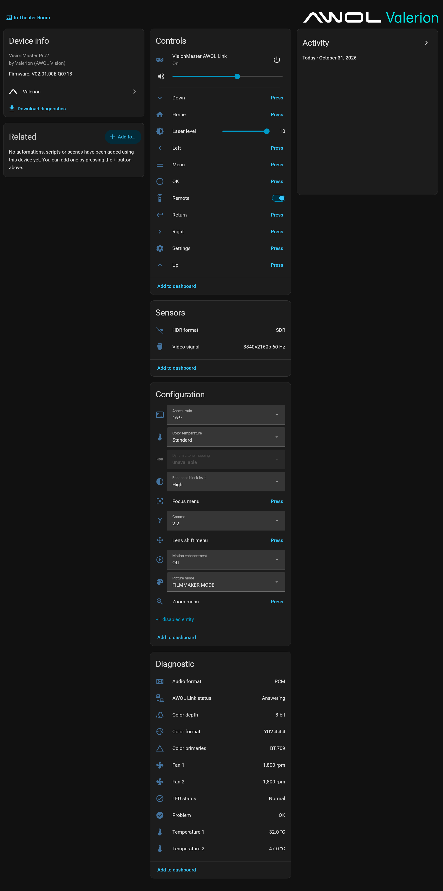

# Valerion projectors for Home Assistant

Local control of Valerion (AWOL Vision) projectors from Home Assistant over **AWOL Link**, the projector's own network control protocol. No cloud, no account, nothing leaves your network.

> **Special thanks to Michael Konieczki, creator of [VMote](https://play.google.com/store/apps/details?id=com.mkonieczki.vmote).**
> VMote is the unofficial Android remote for Valerion projectors and the proof that full local control was possible. Michael supported this project from the start and generously shared the hard-won details of how the projector really behaves on the wire (the security-code handshake, the single-session limit, Wake-on-LAN, which settings are locked in which picture format). Without his generosity this integration would have taken far longer to get right. If you have an Android phone, go get VMote.

Thanks also to [tinogo's Unfolded Circle driver](https://github.com/tinogo/uc-intg-awol-valerion), which served as a second reference for the protocol behaviour.

This is an independent community project, not affiliated with or supported by Valerion or AWOL Vision. The Valerion and AWOL names and logos belong to their owners. AI-assisted tooling was used during development; every change is reviewed by the maintainer and tested on a real projector.

**Status:** early development. v0.1.0 will be the first complete version.

**All testing so far was done on a VisionMaster Pro2.** If you own another model, please [help test it](docs/help-test.md). Everything is done in Home Assistant and most tests take a few minutes.

## Screenshots

VisionMaster Pro2 with a 4K SDR signal:

<p align="center">
  
</p>

## Features

| Entity | What it does |
| --- | --- |
| Media player | Power on and off, input (Home, HDMI 1-3), volume, mute |
| Remote | Sends remote keys by name (see [Remote keys](#remote-keys)) |
| Buttons | Up, down, left, right, OK, return, menu, settings, home. Under Configuration: lens shift, zoom and focus menus |
| Selects | Under Configuration: picture mode, aspect ratio, gamma, dynamic tone mapping, color temperature, enhanced black level, motion enhancement |
| Number | Laser level (0 to 10) |
| Sensors | Video signal and HDR format. Diagnostic: audio format, color depth, color format, color primaries, LED status, fans, temperatures, AWOL Link status |
| Binary sensor | Problem: on when the projector reports a fault (overheating, fan error) |

## What works with which signal

The projector locks some settings depending on the video format. Measured on a VisionMaster Pro2, firmware V02.01.00E.Q0718:

| Setting | SDR | HDR10 | HDR10+ | HLG | Dolby Vision | 3D (MVC) |
| --- | --- | --- | --- | --- | --- | --- |
| Picture mode | Yes | Yes | Yes (Vivid, Game, Standard, Theater) | Yes (same as HDR10) | Yes (Bright, Dark, Custom) | Yes (same as SDR) |
| Gamma | Yes (2.0, 2.2, 2.4, BT.1886) | No, fixed at SMPTE 2084 | No, fixed at SMPTE 2084 | No | No | Yes |
| Dynamic tone mapping | No | Yes | No | No | No | No |
| Color temperature | Yes | Yes | Yes | Yes | Yes | Yes |
| Enhanced black level | Yes, all modes | Yes, all modes | Yes, all modes | Yes, all modes | Yes, all modes | Yes |
| Motion enhancement | Yes, except Film | Yes, except Film | Yes, except Film | Yes, except Film | Yes, except Film | No |
| Aspect ratio | Yes | Yes | Not tested yet | Not tested yet | Yes | No |
| Laser level | Yes | Yes | Yes | Yes | Yes | Yes |

A setting that is locked shows as unavailable in Home Assistant (see [Locked settings](#locked-settings)). Aspect ratio can only be changed while an HDMI signal is playing.

## What works on which projector

AWOL documents AWOL Link for the VisionMaster Pro2, Pro, Max, Plus2 and Plus. Own one of the untested models? See [Help test your projector](docs/help-test.md).

| | VisionMaster Pro2 | VisionMaster Max | Other models |
| --- | --- | --- | --- |
| Tested with this integration | Yes | Not yet | Not yet |
| Standby | Keeps answering; switches on without Wake-on-LAN | Leaves the network after about 30 s; needs Wake-on-LAN | Unknown |
| Aspect ratio | Yes | Yes | Unknown |
| Motion enhancement | Yes, all except Film | Unknown | Unknown |
| Lens shift menu | No (no motorised lens shift; the button hides itself) | Yes | Unknown |
| Zoom menu | Yes | Yes | Unknown |
| Focus menu | Yes | Yes | Unknown |

The Max column comes from Michael Konieczki's tests with VMote.

## Requirements

- Projector firmware V02.01.00E.Q0718 (August 2026) or newer
- Home Assistant 2026.9 or newer
- Home Assistant must reach the projector on TCP port 4352. If the projector is on another network (VLAN), also allow UDP port 9 for Wake-on-LAN.

On the projector:

1. Open **All Settings > Inputs > External Inputs > AWOL Link** and switch **AWOL Link** on. A security code is optional. The *Network IP Control Port* switch is not needed.
2. Set the menu language to **English (US)**. In other languages the projector refuses Warm 1 and Warm 2 color temperature (firmware bug).
3. Give the projector a fixed IP address in your router.
4. Note the MAC address from **All Settings > System > About > Status**. It is needed to switch the projector on from deep standby.

## Installation

### HACS / Marketplace

[](https://my.home-assistant.io/redirect/hacs_repository/?owner=The-HBA&repository=ha-valerion&category=integration)

Or add it by hand: HACS (Settings > Marketplace from Home Assistant 2026.11) > *Custom repositories*, add `https://github.com/The-HBA/ha-valerion` as *Integration*, download **Valerion** and restart Home Assistant.

### Manual

Copy `custom_components/valerion` into the `custom_components` folder of your Home Assistant configuration and restart.

## Setup

Settings > Devices & services > Add integration > **Valerion**. Enter the IP address, port 4352, the security code if you set one, and the MAC address. The projector must be on or in standby.

To add or change the MAC address later, open Settings > Devices & services > Valerion and press the gear button next to the projector.

## Removal

1. Settings > Devices & services > Valerion > three dots > **Delete**. This also deletes the learned locks.
2. HACS > Valerion > three dots > **Remove**, then restart Home Assistant.

## Remote keys

`up`, `down`, `left`, `right`, `ok`, `return`, `menu`, `settings`, `home`, `volume_up`, `volume_down`, `lens_shift`, `zoom`, `focus`

```yaml
action: remote.send_command
target:
  entity_id: remote.visionmaster_pro2_remote
data:
  command: [down, down, ok]
  delay_secs: 0.5
```

Keys are only sent while the projector is on.

## Send raw command

`valerion.send_raw_command` sends one AWOL Link line and returns the reply, for example `%1POWR ?` returns `%1POWR=1`. Useful for testing and for commands without an entity. `ERR2` means invalid value, `ERR3` means not available for the current signal.

```yaml
action: valerion.send_raw_command
data:
  command: "%3ASPR ?"
response_variable: reply
```

## How it works

AWOL Link allows only one control connection at a time. If something holds it open, other apps that use AWOL Link stop working. This integration never keeps the connection: every poll and command connects, does its work and disconnects.

Home Assistant reads the projector every 10 seconds while it is on and every 30 seconds in standby. Picture settings, fans and temperatures are read about once a minute, and right after the picture mode changes.

Switching on sends a Wake-on-LAN packet to the MAC address, both as a broadcast and straight to the projector's IP address so it also crosses VLANs, and repeats it for up to 45 seconds. The *AWOL Link status* sensor shows how the projector sleeps: *answering*, *silent* (deep standby, or another app is connected), *refused* (AWOL Link is off) or *unreachable*.

## Locked settings

The projector reports a value even for a setting it will not change, so Home Assistant only sees a lock when a change is refused. Two kinds of locks make the setting unavailable for the current signal format and picture mode:

- **Built-in:** the locks in the signal table above.
- **Learned:** when the projector refuses a change as locked, Home Assistant remembers it for that format and picture mode. Learned locks survive restarts and are forgotten after a firmware update.

Menus work the same way. If the projector refuses the lens shift, zoom or focus menu, the model does not have it, and Home Assistant hides that button.

If a setting stays unavailable or a menu button stays hidden when it should not, enable and press the *Forget learned locks* button on the device page.

## Known limitations

- No play/pause or media information. AWOL Link does not reach the Android TV side of the projector.
- Changes made with the IR remote can take up to a minute to show.
- Aspect ratio is read-only in AWOL's command list, but setting it works with a signal playing (tested on the Pro2 and the Max). It is the only command used that is not in the official list.
- AWOL Link cannot report the MAC address, so it has to be entered by hand.
- On another VLAN, the Wake-on-LAN packet sent to the projector's IP only arrives while the router still remembers its MAC address. Add a static ARP entry on the router for a projector that leaves the network in standby.
- After more than a day in standby the Max sometimes switches Wi-Fi off completely. Only the IR remote wakes it then.
- The signal code meanings come from AWOL support via Michael Konieczki. Dolby TrueHD Atmos shows as *Dolby Audio*, and *Several audio tracks* means the file has more than one audio track.

## Troubleshooting

| Problem | What to check |
| --- | --- |
| Setup says *could not reach the projector* | The IP address is right and the projector is on. Between networks (VLANs), the router allows TCP 4352 from Home Assistant to the projector. See [Requirements](#requirements). |
| Setup says *the projector refused the connection* | AWOL Link is switched off on the projector. See [Requirements](#requirements), step 1. |
| Setup says *accepted the connection but did not answer* | The projector is in deep standby, or another app that uses AWOL Link is connected. Switch the projector on and close that app. See [How it works](#how-it-works). |
| Setup says *rejected the security code* | Enter the code exactly as set under AWOL Link on the projector. |
| The projector does not switch on from standby | The MAC address is set (gear button, see [Setup](#setup)) and UDP 9 is allowed to the projector. After more than a day in standby some models only wake by IR. See [Known limitations](#known-limitations). |
| A setting is greyed out | It is locked for the current signal and picture mode. See [What works with which signal](#what-works-with-which-signal) and [Locked settings](#locked-settings). |
| Warm 1 or Warm 2 color temperature is refused | Set the projector's menu language to English (US). |
| A menu button or motion mode shows an error | Your model may not have it. See [What works on which projector](#what-works-on-which-projector). |
| A lens shift, zoom or focus button disappeared | The projector refused that menu, so it was hidden. See [Locked settings](#locked-settings) to bring it back. |
| Another app that uses AWOL Link cannot connect | Only one app can be connected at a time. The integration connects for a moment every 10 seconds (every 30 in standby). An app that connects during that moment waits until the integration is done. See [How it works](#how-it-works). |
| A change made with the IR remote shows late | Settings are read about once a minute. |

### Reporting a problem

Please include in an issue: Home Assistant version, integration version, projector model and firmware, whether a security code is set, and the diagnostics download (device page > three dots > Download diagnostics). Debug logging on the integration page captures the raw protocol exchange.

## Related projects

- [VMote](https://play.google.com/store/apps/details?id=com.mkonieczki.vmote), the Android remote by Michael Konieczki
- [tinogo/uc-intg-awol-valerion](https://github.com/tinogo/uc-intg-awol-valerion), AWOL Link for Unfolded Circle remotes
- [Official AWOL Link article](https://support.valerion.com/hc/en-us/articles/17088458288143-What-is-AWOL-Link) with the command list

## License

[MIT](LICENSE)
