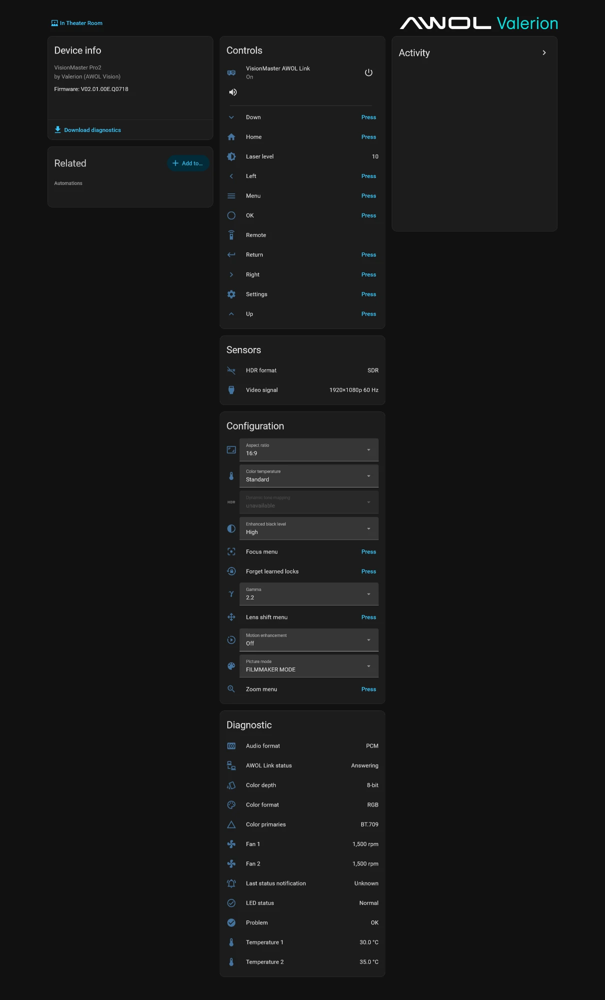
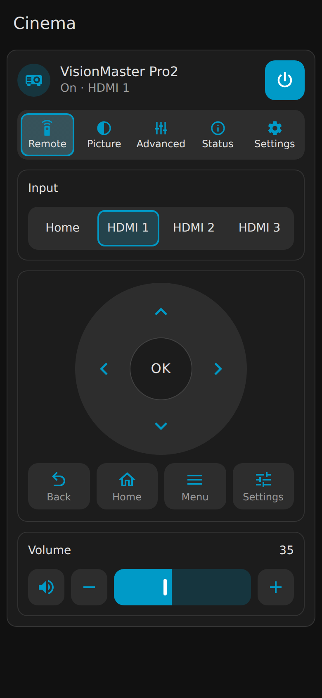
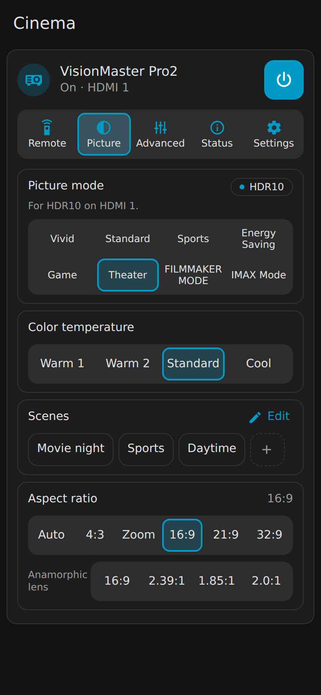
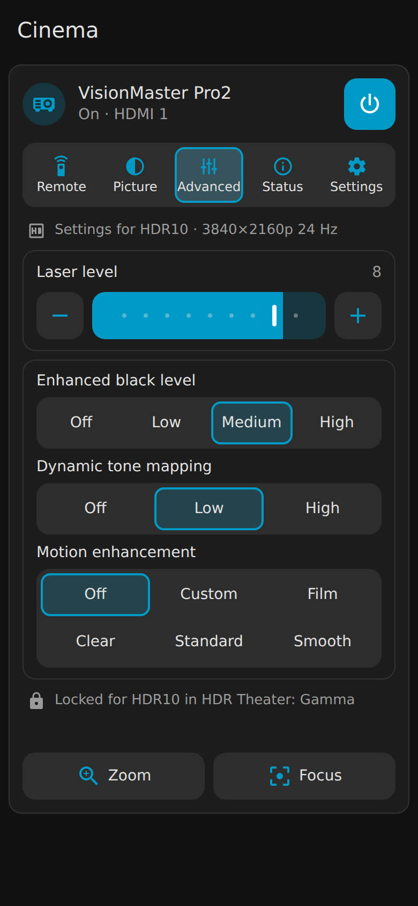
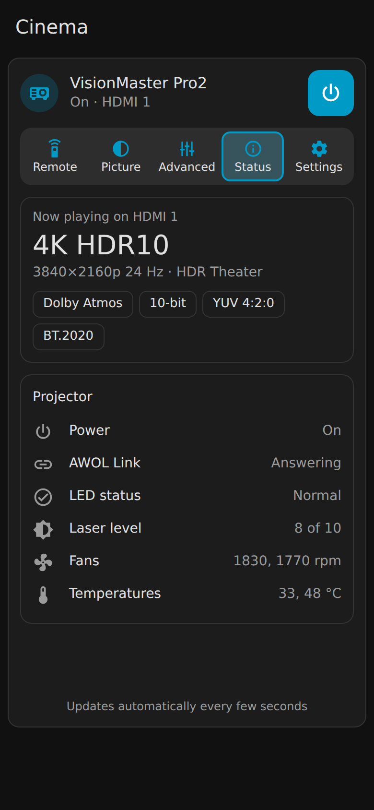
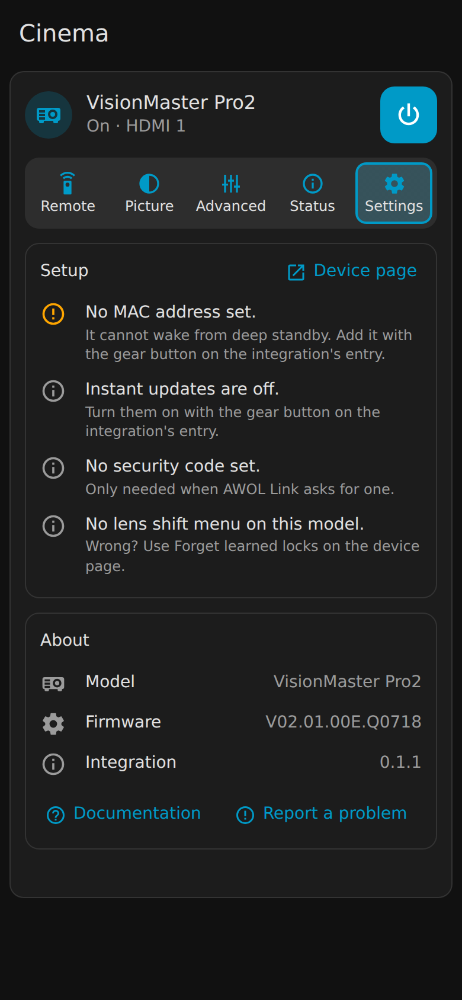
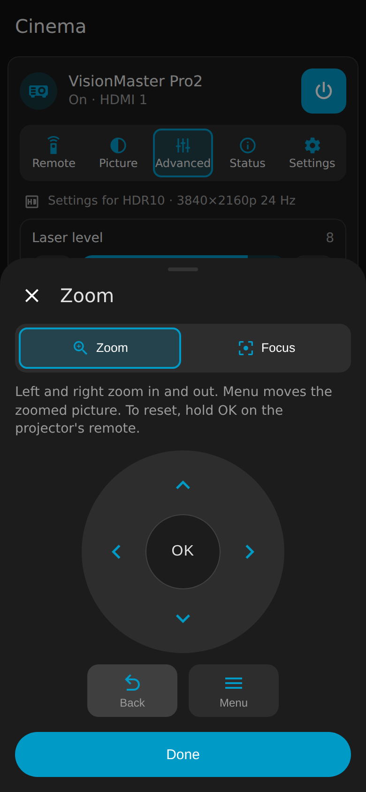
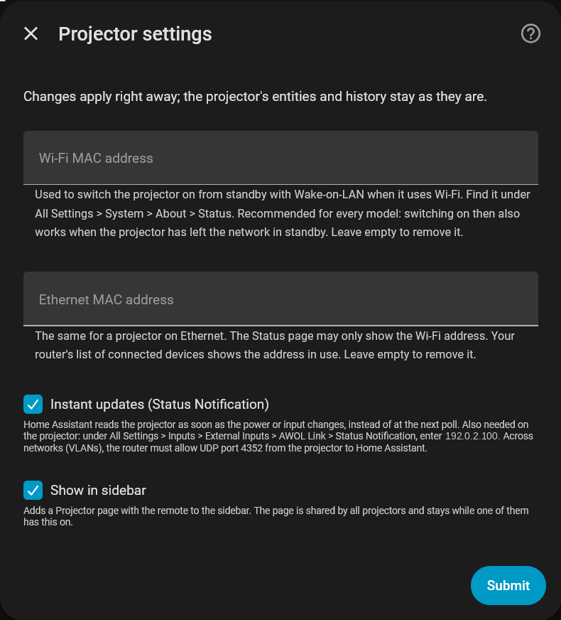

# Valerion projectors for Home Assistant

Local control of Valerion (AWOL Vision) projectors from Home Assistant over **AWOL Link**, the projector's own network control protocol. No cloud, no account, nothing leaves your network.

> **Special thanks to Michael Konieczki, creator of [VMote](https://play.google.com/store/apps/details?id=com.mkonieczki.vmote).**
> VMote is the unofficial Android remote for Valerion projectors and the proof that full local control was possible. Michael supported this project from the start and generously shared the hard-won details of how the projector really behaves on the wire (the security-code handshake, the single-session limit, Wake-on-LAN, which settings are locked in which picture format). Without his generosity this integration would have taken far longer to get right. If you have an Android phone, go get VMote.

Thanks also to [tinogo's Unfolded Circle driver](https://github.com/tinogo/uc-intg-awol-valerion), which served as a second reference for the protocol behaviour.

This is an independent community project, not affiliated with or supported by Valerion or AWOL Vision. The Valerion and AWOL names and logos belong to their owners. AI-assisted tooling was used during development; the maintainer tests the integration on a real projector.

**Status:** v0.1.1 adds the Picture and Advanced tabs, scenes and the lens sheet to the card. Please [report](https://github.com/The-HBA/ha-valerion/issues) anything that looks wrong.

**Most testing so far was done on a VisionMaster Pro2, plus user reports from a VisionMaster Plus2 and an Aetherion Max.** If you own another model, please [help test it](docs/help-test.md). Everything is done in Home Assistant and most tests take a few minutes.

## Screenshots

VisionMaster Pro2 with a 1080p SDR signal:

<p align="center">
  
</p>

The remote card on a phone: Remote, Picture and Advanced tabs, then Status, Settings and the zoom sheet:

<p align="center">
  
  
  
</p>
<p align="center">
  
  
  
</p>

## Features

| Entity | What it does |
| --- | --- |
| Media player | Power on and off, input (Home, HDMI 1-3), volume, mute |
| Remote | Sends remote keys by name (see [Remote keys](#remote-keys)). Its switch is the projector's power switch, the same as the media player |
| Buttons | Up, down, left, right, OK, return, menu, settings, home. Under Configuration: lens shift, zoom and focus menus |
| Selects | Under Configuration: picture mode, aspect ratio, gamma, dynamic tone mapping, color temperature, enhanced black level, motion enhancement |
| Number | Laser level (0 to 10) |
| Sensors | Video signal and HDR format. Diagnostic: audio format, color depth, color format, color primaries, LED status, fans, temperatures, AWOL Link status. With [instant updates](#instant-updates-optional) on: last status notification |
| Binary sensor | Problem: on when the projector reports a fault (overheating, fan error) |
| Scenes | One scene entity per saved scene (picture settings applied together). Created on the card's Picture tab, see [Remote card](#remote-card) |
| Remote card | A dashboard card with tabs. See [Remote card](#remote-card) |
| Sidebar page | *Projector* in the sidebar shows the card full screen. See [Remote card](#remote-card) |

## What works with which signal

The projector locks some settings depending on the video format. Measured on a VisionMaster Pro2, firmware V02.01.00E.Q0718:

| Setting | SDR | HDR10 | HDR10+ | HLG | Dolby Vision | 3D (MVC) |
| --- | --- | --- | --- | --- | --- | --- |
| Picture mode | Yes | Yes | Yes (Vivid, Game, Standard, Theater) | Yes (same as HDR10) | Yes (Bright, Dark, Custom) | Yes (same as SDR) |
| Gamma | Yes (2.0, 2.2, 2.4, BT.1886) | No, fixed at SMPTE 2084 | No, fixed at SMPTE 2084 | No | No | Yes |
| Dynamic tone mapping | No | Yes | No | No | No | No |
| Color temperature | Yes | Yes | Yes | Yes | Yes | Yes |
| Enhanced black level | Yes, all modes | Yes, all modes | Yes, all modes | Yes, all modes | Yes, all modes | Yes |
| Motion enhancement | Yes, except Film | Yes, except Film | Yes, except Film | Yes, except Film | Yes, except Film | No |
| Aspect ratio | Yes | Yes | Yes | Yes | Yes | No |
| Laser level | Yes | Yes | Yes | Yes | Yes | Yes |

A setting that is locked shows as unavailable in Home Assistant (see [Locked settings](#locked-settings)). Aspect ratio can only be changed while an HDMI signal is playing.

## What works on which projector

AWOL documents AWOL Link for the VisionMaster Pro2, Pro, Max, Plus2 and Plus. One user report shows it also answers on the Aetherion Max. Own one of the untested models? See [Help test your projector](docs/help-test.md).

| | VisionMaster Pro2 | VisionMaster Max | VisionMaster Plus2 | Aetherion Max | Other models |
| --- | --- | --- | --- | --- | --- |
| Tested with this integration | Yes | Not yet | One user report | One user report | Not yet |
| Standby | Keeps answering; switches on without Wake-on-LAN | Leaves the network after about 30 s; needs Wake-on-LAN | Leaves the network after about 30 s; needs Wake-on-LAN | Leaves the network; switching on timed out (under investigation) | Unknown |
| Security code | Yes | Not tested yet | Not tested yet | Reported as rejected (under investigation) | Unknown |
| Aspect ratio | Yes | Yes | Unknown | Unknown | Unknown |
| Motion enhancement | Yes, all except Film | Film works; others not reported | Unknown | Unknown | Unknown |
| Lens shift menu | No (no motorised lens shift; the button hides itself) | Yes | No (the projector refuses it; the button hides itself) | Unknown | Unknown |
| Zoom menu | Yes | Yes | Unknown | Unknown | Unknown |
| Focus menu | Yes | Yes | Unknown | Unknown | Unknown |

The Max column comes from Michael Konieczki's tests with VMote. The Plus2 and Aetherion Max columns each come from one user report, on firmware V0000.01.00E.Q0718 and V0000.01.00U.Q1015.

## Requirements

- Projector firmware V02.01.00E.Q0718 (August 2026) or newer. User reports show V0000.01.00E.Q0718 on the Plus2 and V0000.01.00U.Q1015 on the Aetherion Max, and AWOL Link answered on both.
- Home Assistant 2026.9 or newer
- Home Assistant must reach the projector on TCP port 4352. If the projector is on another network (VLAN), also allow UDP port 9 for Wake-on-LAN.

On the projector:

1. Open **All Settings > Inputs > External Inputs > AWOL Link** and switch **AWOL Link** on. A security code is optional. To set one, switch AWOL Link off, enter the code and switch AWOL Link on again. The *Network IP Control Port* switch is not needed.
2. Set the menu language to **English (US)**. In other languages the projector refuses Warm 1 and Warm 2 color temperature (firmware bug).
3. Give the projector a fixed IP address in your router.
4. Note the MAC address of the connection the projector uses. It is needed to switch the projector on from deep standby. **All Settings > System > About > Status** shows the Wi-Fi address. For Ethernet, see your router's list of connected devices.

## Installation

### Marketplace (Home Assistant 2026.11 and newer)

HACS is now built into Home Assistant as the Marketplace.

[](https://my.home-assistant.io/redirect/hacs_repository/?owner=The-HBA&repository=ha-valerion&category=integration)

Or add it by hand:

1. Settings > Marketplace > **Add from link**. The Marketplace asks you to connect GitHub the first time. That connection only reads public information.
2. Enter `The-HBA/ha-valerion` and select **Add**.
3. Download **Valerion** and restart Home Assistant.

### HACS (Home Assistant 2026.9 and 2026.10)

Use the button above, or HACS > *Custom repositories*, add `https://github.com/The-HBA/ha-valerion` as *Integration*. Download **Valerion** and restart Home Assistant.

### Manual

Copy `custom_components/valerion` into the `custom_components` folder of your Home Assistant configuration and restart.

## Setup

Home Assistant finds the projector by itself and shows it under *Discovered* on Settings > Devices & services. Press **Add** and enter the security code if you set one. If AWOL Link is switched off, Home Assistant says so. Switch it on and press **Submit**.

**Add integration > Valerion** first searches the network and lists the projectors it finds. Choose yours, or *Enter the IP address manually*. The search only finds projectors with AWOL Link on, and only on the same network as Home Assistant.

To enter it by hand: enter the IP address, port 4352, the security code if you set one, and the Wi-Fi MAC address, the Ethernet MAC address or both. The projector must be on or in standby.

To add or change a MAC address later, open Settings > Devices & services > Valerion and press the gear button next to the projector. The same window switches [instant updates](#instant-updates-optional) and the sidebar page on and off.

<p align="center">
  
</p>

To change the IP address, port or security code, use **Reconfigure** in the three-dot menu of the same entry. Entities and history stay.

If a security code is set or changed on the projector, Home Assistant shows *Reauthentication required* on the Integrations page. Enter the new code there.

### Instant updates (optional)

Home Assistant then reads the projector as soon as the power or input changes, instead of at the next poll.

1. Press the gear button and switch on **Instant updates**. The text below it shows the address to use.
2. On the projector, enter that address under All Settings > Inputs > External Inputs > AWOL Link > Status Notification.
3. Across VLANs, allow UDP 4352 from the projector to Home Assistant.
4. Change the input. The *Last status notification* sensor should show the time.

| Good to know | |
| --- | --- |
| Only one address | The projector sends to one address only. |
| Switching it off | The projector's field does not save empty. Enter `127.0.0.1` to stop the messages. |
| Not covered | Volume sent nothing in our test, and signal changes are not tested. Those still show at the next poll. |
| Docker | The container needs host networking, or UDP 4352 published. |
| Tested on | VisionMaster Pro2. Other models may send different messages. |

## Remote card

The card is installed with the integration. Edit a dashboard, add a card and choose **Valerion projector**, then pick the projector.

| Tab | What it shows |
| --- | --- |
| Remote | Inputs, arrow keys and OK, back, home, menu, settings, volume and mute. Hold an arrow or volume key to repeat it |
| Picture | Picture mode for what is playing, color temperature, aspect ratio (also for anamorphic lenses) and scenes |
| Advanced | Laser level, enhanced black level, dynamic tone mapping, gamma, motion enhancement, and the lens shift, zoom and focus menus |
| Status | The signal now playing, picture mode, power, AWOL Link, LED status, laser level, fans and temperatures |
| Settings | Setup tips, such as a missing MAC address, model, firmware and version |

While the projector is off, only power, Status and Settings can be used.

Settings the projector locks for the current format, such as gamma in HDR10, are hidden. One grey line names them.

**Lens menus:** Zoom, Focus or Lens shift opens the projector's menu and a sheet with only the keys that menu uses. Done closes the menu again. Only the menus your model has are shown.

**Scenes:** a scene saves picture settings to apply in one tap, for example *Movie night*. Admins create and edit them with *New* and *Edit* on the Picture tab. Each scene is also a scene entity, so automations and voice assistants can use it. If the scene's picture mode is not offered for what is playing, the scene is not applied and the card says why.

**Sidebar page:** *Projector* in the sidebar shows the same card full screen, with a choice of projector if you have more than one. To hide it, press the gear button next to the projector and switch off **Show in sidebar**.

## Removal

1. Settings > Devices & services > Valerion > three dots > **Delete**. This also deletes the learned locks.
2. Remove the files, then restart Home Assistant:
   - Marketplace: open Valerion, three dots > **Uninstall**.
   - HACS: Valerion > three dots > **Remove**.

## Remote keys

`up`, `down`, `left`, `right`, `ok`, `return`, `menu`, `settings`, `home`, `volume_up`, `volume_down`, `lens_shift`, `zoom`, `focus`

```yaml
action: remote.send_command
target:
  entity_id: remote.visionmaster_pro2_remote
data:
  command: [down, down, ok]
  delay_secs: 0.5
```

Keys are only sent while the projector is on.

## Send raw command

`valerion.send_raw_command` sends one AWOL Link line and returns the reply, for example `%1POWR ?` returns `%1POWR=1`. Useful for testing and for commands without an entity. `ERR2` means invalid value, `ERR3` means not available for the current signal.

```yaml
action: valerion.send_raw_command
data:
  command: "%3ASPR ?"
response_variable: reply
```

## What you can do with it

| Idea | Uses |
| --- | --- |
| Lights go down when the projector switches on | Media player state |
| Laser level or picture mode follows the film's format | HDR format sensor, laser level, picture mode |
| Switch off when the source has gone quiet | HDR format sensor, media player |
| A message when the projector reports a fault | Problem binary sensor |
| One dashboard button for a whole setup: input, aspect ratio, laser | Media player, aspect ratio, laser level |

## Examples

Replace `visionmaster_pro2` with your projector's name, as shown on its device page.

**Lights down when the projector switches on**

```yaml
triggers:
  - trigger: state
    entity_id: media_player.visionmaster_pro2
    to: "on"
actions:
  - action: light.turn_off
    target:
      area_id: living_room
```

**Lower laser level for SDR**

```yaml
triggers:
  - trigger: state
    entity_id: sensor.visionmaster_pro2_hdr_format
    to: sdr
actions:
  - action: number.set_value
    target:
      entity_id: number.visionmaster_pro2_laser_level
    data:
      value: 7
```

The other formats are `hdr10`, `hdr10_plus`, `hlg`, `dolby_vision` and `no_signal`.

**Picture mode for HDR10**

Mode names change with the format and the model. The *Picture mode* entity lists the ones you can use.

```yaml
triggers:
  - trigger: state
    entity_id: sensor.visionmaster_pro2_hdr_format
    to: hdr10
    for:
      seconds: 15
actions:
  - action: select.select_option
    target:
      entity_id: select.visionmaster_pro2_picture_mode
    data:
      option: HDR Theater
```

**Switch off after 30 minutes without a signal**

```yaml
triggers:
  - trigger: state
    entity_id: sensor.visionmaster_pro2_hdr_format
    to: no_signal
    for:
      minutes: 30
conditions:
  - condition: state
    entity_id: media_player.visionmaster_pro2
    state: "on"
actions:
  - action: media_player.turn_off
    target:
      entity_id: media_player.visionmaster_pro2
```

**Message on a fault**

```yaml
triggers:
  - trigger: state
    entity_id: binary_sensor.visionmaster_pro2_problem
    to: "on"
actions:
  - action: persistent_notification.create
    data:
      title: Projector
      message: "The projector reports a fault: {{ states('sensor.visionmaster_pro2_led_status') }}"
```

## How it works

AWOL Link allows only one control connection at a time. If something holds it open, other apps that use AWOL Link stop working. This integration never keeps the connection: every poll and command connects, does its work and disconnects.

Home Assistant reads the projector every 10 seconds while it is on and every 30 seconds in standby. Picture settings, fans and temperatures are read about once a minute, and right after the picture mode changes.

With [instant updates](#instant-updates-optional) on, a message from the projector starts a poll right away, at most once every 10 seconds. Messages have no security code, so one is never used as the projector's state, and only messages from the projector's own address count. Polling carries on as usual.

Switching on sends a Wake-on-LAN packet to each MAC address you entered, both as a broadcast and straight to the projector's IP address so it also crosses VLANs, and repeats it for up to 45 seconds. The *AWOL Link status* sensor shows how the projector sleeps: *answering*, *silent* (deep standby, or another app is connected), *refused* (AWOL Link is off) or *unreachable*.

## Locked settings

The projector reports a value even for a setting it will not change, so Home Assistant only sees a lock when a change is refused. Two kinds of locks make the setting unavailable for the current signal format and picture mode:

- **Built-in:** the locks in the signal table above.
- **Learned:** when the projector refuses a change as locked, Home Assistant remembers it for that format and picture mode. Learned locks survive restarts and are forgotten after a firmware update.

3D counts as its own format. The projector reports 3D as SDR, so Home Assistant recognizes it by the picture size (two pictures stacked, for example 1920×2205) and shows it as *1920×1080p 24 Hz 3D*.

Menus work the same way. If the projector refuses the lens shift, zoom or focus menu, the model does not have it, and Home Assistant hides that button.

If a setting stays unavailable or a menu button stays hidden when it should not, enable and press the *Forget learned locks* button on the device page.

## Known limitations

- No play/pause or media information. AWOL Link does not reach the Android TV side of the projector.
- Changes made with the IR remote can take up to a minute to show.
- Aspect ratio is read-only in AWOL's command list, but setting it works with a signal playing (tested on the Pro2 and the Max). It is the only command used that is not in the official list.
- AWOL Link cannot report the MAC address, so it has to be entered by hand.
- On another VLAN, the Wake-on-LAN packet sent to the projector's IP only arrives while the router still remembers its MAC address. Add a static ARP entry on the router for a projector that leaves the network in standby.
- After more than a day in standby the Max sometimes switches Wi-Fi off completely. Only the IR remote wakes it then.
- The signal code meanings come from AWOL support via Michael Konieczki. Dolby TrueHD Atmos shows as *Dolby Audio*, and *Several audio tracks* means the file has more than one audio track.

## Troubleshooting

| Problem | What to check |
| --- | --- |
| The card is not in the list of cards, or shows *Custom element doesn't exist* | Restart Home Assistant after installing, then reload the browser page. In the Companion app, use *Reset frontend cache* in the app settings. |
| Setup says *could not reach the projector* | The IP address is right and the projector is on. Between networks (VLANs), the router allows TCP 4352 from Home Assistant to the projector. See [Requirements](#requirements). |
| Setup says *the projector refused the connection* | AWOL Link is switched off on the projector. See [Requirements](#requirements), step 1. |
| Setup says *accepted the connection but did not answer* | The projector is in deep standby, or another app that uses AWOL Link is connected. Switch the projector on and close that app. See [How it works](#how-it-works). |
| Setup says *rejected the security code* | Enter the code exactly as set under AWOL Link on the projector. |
| *Reauthentication required* on the Integrations page | The security code on the projector was set or changed. Open the notice and enter the new code. |
| The projector does not switch on from standby | The MAC address of the connection in use is set (gear button, see [Setup](#setup)): Wi-Fi and Ethernet have different addresses. UDP 9 must be allowed to the projector. After more than a day in standby some models only wake by IR. See [Known limitations](#known-limitations). |
| A setting is greyed out | It is locked for the current signal and picture mode. See [What works with which signal](#what-works-with-which-signal) and [Locked settings](#locked-settings). |
| Warm 1 or Warm 2 color temperature is refused | Set the projector's menu language to English (US). |
| A menu button or motion mode shows an error | Your model may not have it. See [What works on which projector](#what-works-on-which-projector). |
| A lens shift, zoom or focus button disappeared | The projector refused that menu, so it was hidden. See [Locked settings](#locked-settings) to bring it back. |
| Another app that uses AWOL Link cannot connect | Only one app can be connected at a time. The integration connects for a moment every 10 seconds (every 30 in standby). An app that connects during that moment waits until the integration is done. See [How it works](#how-it-works). |
| A change made with the IR remote shows late | Settings are read about once a minute. Power and input can show at once with [instant updates](#instant-updates-optional). |
| *Last status notification* stays empty | The address is entered on the projector. Across VLANs, the router allows UDP 4352 from the projector to Home Assistant. See [Instant updates](#instant-updates-optional). |
| *Valerion cannot listen for instant updates* | Another program uses UDP port 4352 on the Home Assistant machine. Everything else keeps working. Close that program and reload the integration, or switch instant updates off. |

### Reporting a problem

Please include in an issue: Home Assistant version, integration version, projector model and firmware, whether a security code is set, and the diagnostics download (device page > three dots > Download diagnostics). Debug logging on the integration page captures the raw protocol exchange.

## Related projects

- [VMote](https://play.google.com/store/apps/details?id=com.mkonieczki.vmote), the Android remote by Michael Konieczki
- [tinogo/uc-intg-awol-valerion](https://github.com/tinogo/uc-intg-awol-valerion), AWOL Link for Unfolded Circle remotes
- [Official AWOL Link article](https://support.valerion.com/hc/en-us/articles/17088458288143-What-is-AWOL-Link) with the command list

## License

[MIT](LICENSE)
